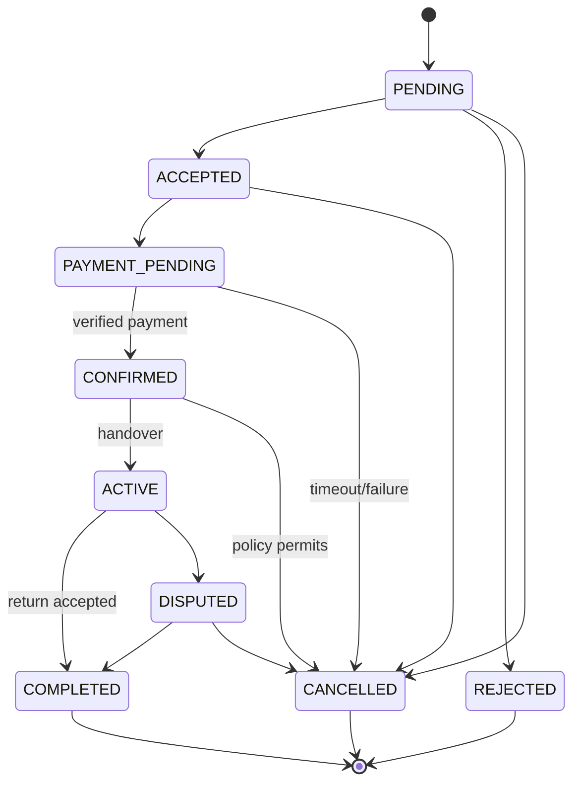

# Technical architecture

## Architecture decision

Use a modular monolith for the MVP: React SPA → Flask REST API → PostgreSQL. This is simpler to develop, test and deploy than microservices while retaining clear domain boundaries through Flask blueprints and service modules.

## Components

- **Frontend:** React + Vite + JavaScript + Tailwind CSS + React Router + Axios. Context is sufficient for auth/session state initially; server state can later move to TanStack Query if complexity warrants it.
- **Backend:** Flask application factory, blueprints, SQLAlchemy 2.x, Flask-Migrate/Alembic, Marshmallow or Pydantic validation, Flask-Limiter, Flask-WTF CSRF protection for cookie-authenticated state-changing requests.
- **Database:** PostgreSQL. Use UUID primary keys, UTC timestamps, INR amounts as integer paise, database constraints and indexes.
- **Images:** Cloudinary signed uploads; validate MIME type, extension, size and ownership. Persist provider asset IDs and secure URLs.
- **Payments:** Razorpay Orders/Payments in test mode only after merchant account setup. Verify signatures server-side; webhook signature verification and idempotency. Do not store card details.
- **Email:** provider adapter (Resend/Postmark/SES to be selected after sender-domain decision).
- **Maps:** defer until product-market validation; store normalized locality and optional coordinates now. Do not expose exact owner address publicly.

## Authentication and authorization

Use opaque server-side sessions in secure, HttpOnly, SameSite cookies. Production cookies require HTTPS. CSRF tokens protect unsafe browser requests. Passwords use Argon2id (or Werkzeug's current scrypt implementation if dependency constraints dictate). Roles are checked on every protected operation; resource ownership is checked separately. Admin grants are not self-selectable at signup.

## Booking concurrency design

Represent requested dates as half-open ranges `[start_date, end_date)`. PostgreSQL `daterange`/`tstzrange` exclusion constraint with GiST prevents overlaps for the same product among blocking statuses (`PAYMENT_PENDING`, `CONFIRMED`, `ACTIVE`). Enable `btree_gist`. Booking acceptance and payment-window creation occur in a transaction; a unique idempotency key protects retries. Expired payment holds are released by a scheduled cleanup job. Backend availability checks improve UX, but the exclusion constraint is the final concurrency guard.

## Booking state machine

All transitions are validated by a domain service and recorded in `booking_events`. Payment webhooks are idempotent and may only confirm a booking after provider-side verification.

## Deployment topology

- Frontend: Vercel (static SPA)
- API: Render or equivalent managed Python service
- Database: managed PostgreSQL with automated backups
- Secrets: hosting secret manager/environment variables
- Observability: structured logs, error reporting and uptime checks

## Security baseline

HTTPS; secure cookies; CSRF; CORS allowlist; password hashing; request validation; rate limits; SQLAlchemy parameterized queries; output escaping; upload restrictions; authorization tests; webhook signature verification; idempotency; audit logs; backups; data minimization; no Aadhaar storage. Legal/privacy/payment policies require qualified review before public launch.
