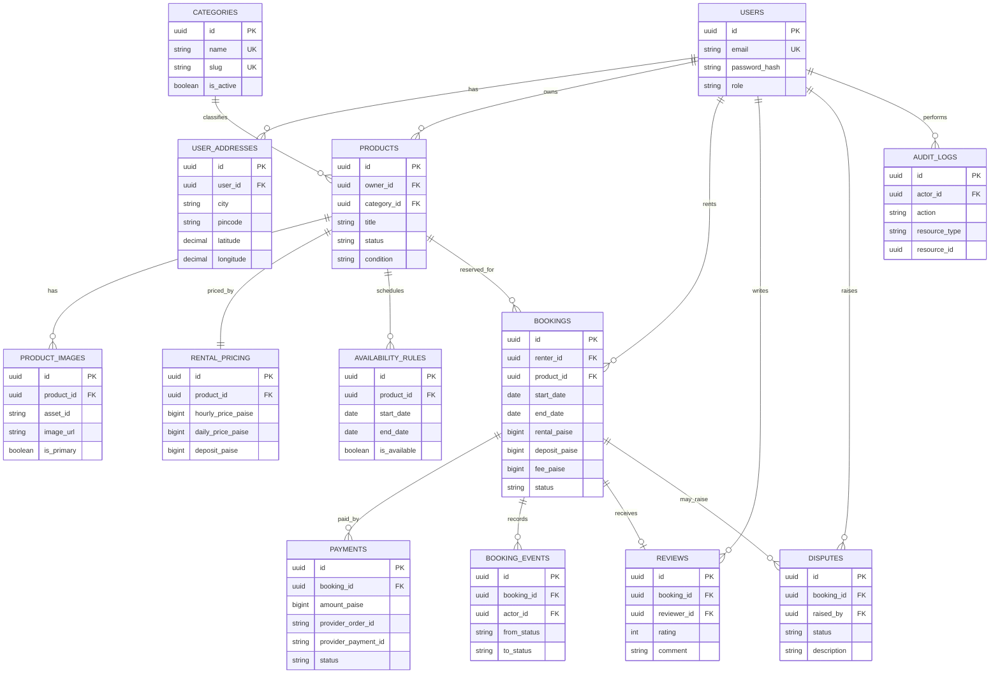

# Database design

## ER diagram

## Important constraints and indexes

- `users.email` unique (case-insensitive normalized email); phone unique only when verified and present.
- `categories.slug` unique.
- `rental_pricing.product_id` unique; prices and deposit non-negative; at least one hourly/daily price must be positive.
- `products.owner_id`, `category_id` indexed; search index on approved/active listings.
- `bookings.start_date < bookings.end_date`; amounts non-negative; renter cannot book own product.
- PostgreSQL exclusion constraint on `(product_id WITH =, daterange(start_date,end_date,'[)') WITH &&)` for blocking statuses. Implement partial GiST index with `btree_gist`; verify generated SQL in migration.
- `payments.provider_payment_id` unique when non-null; webhook event ID unique.
- One review per completed booking; rating 1–5.
- Foreign keys use restrictive deletes for financial and booking records; archive users/products rather than destructive cascades.
- Store money as integer paise, never floating point. Store UTC timestamps; date-only rental periods are interpreted in Asia/Kolkata for the pilot.

## Additional tables beyond the original brief

`booking_events`, `audit_logs`, `payment_webhook_events`, `owner_verifications`, `reports`, and `wishlist_items` support auditability, idempotency, moderation and the renter experience. Exact columns will be implemented alongside the relevant feature.
